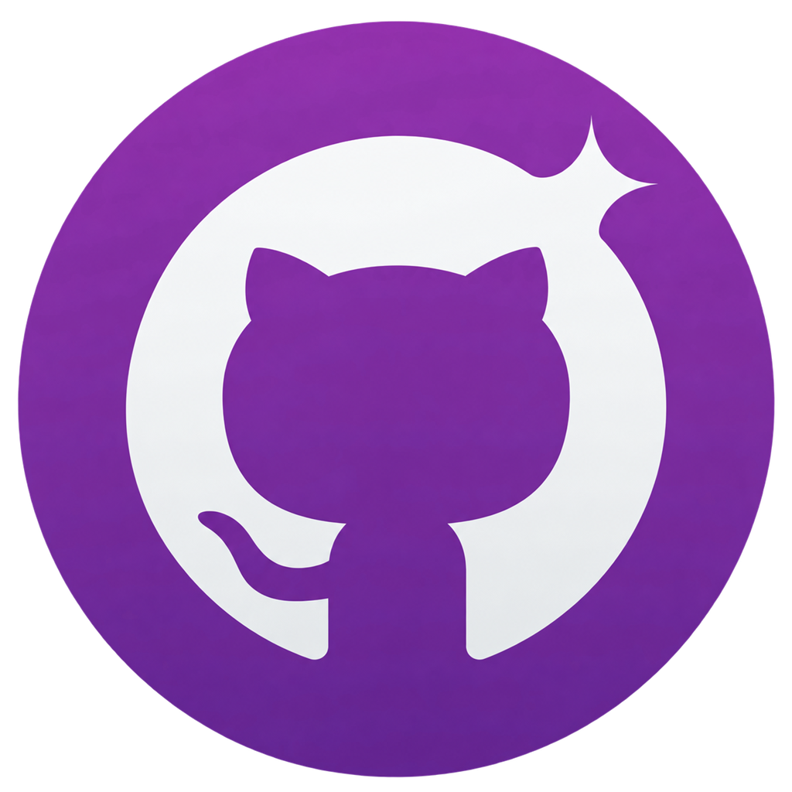
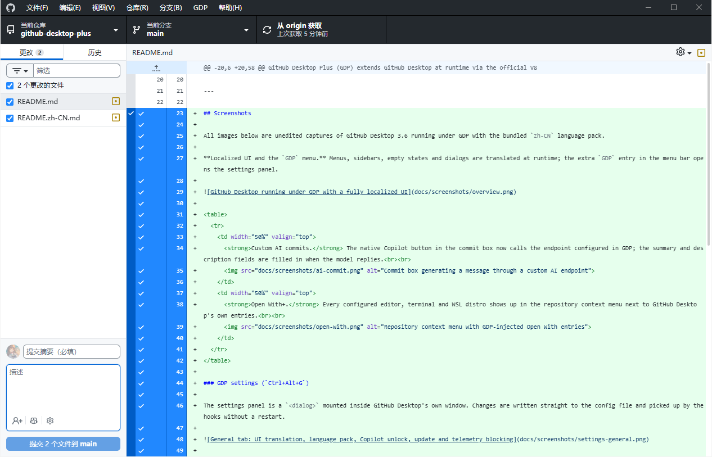
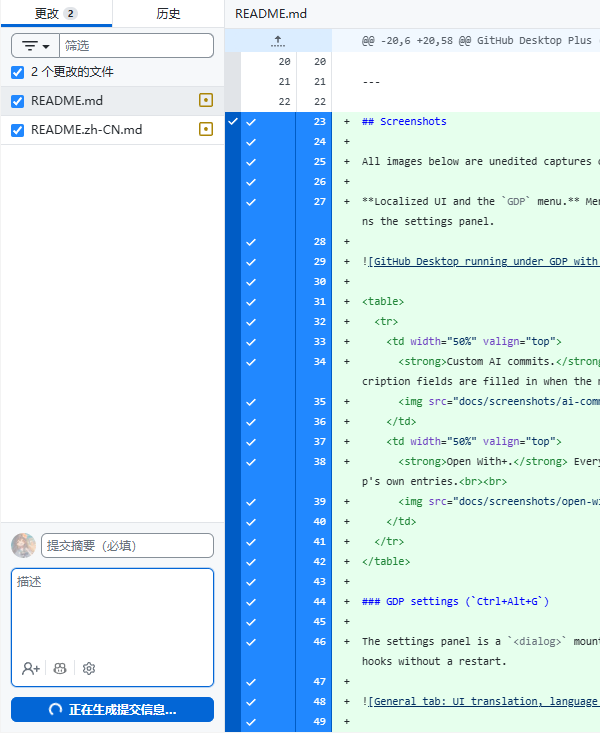
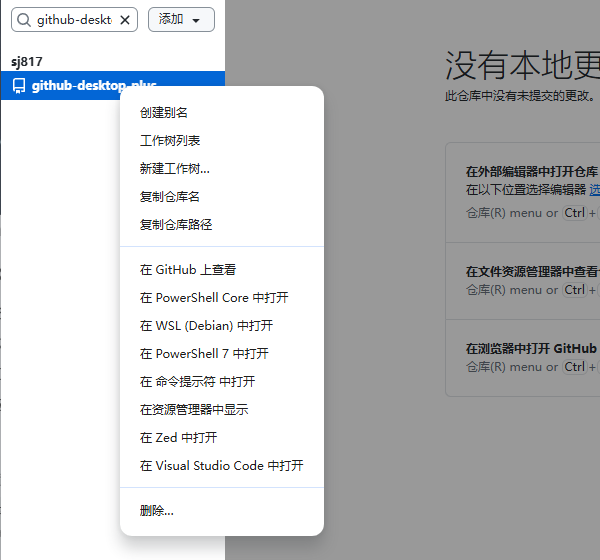
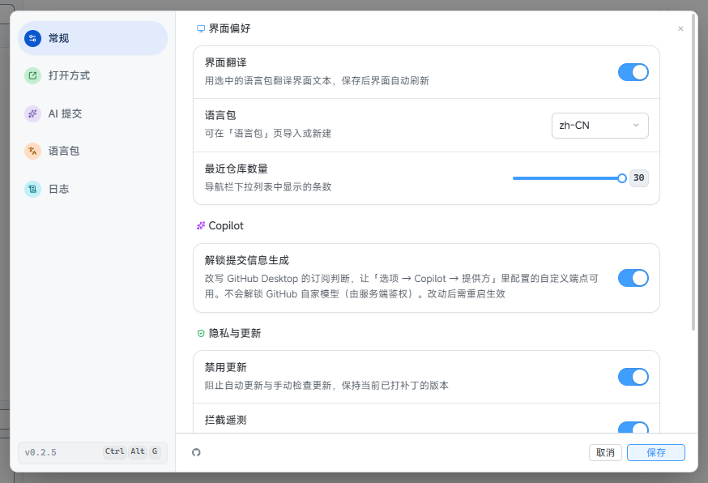
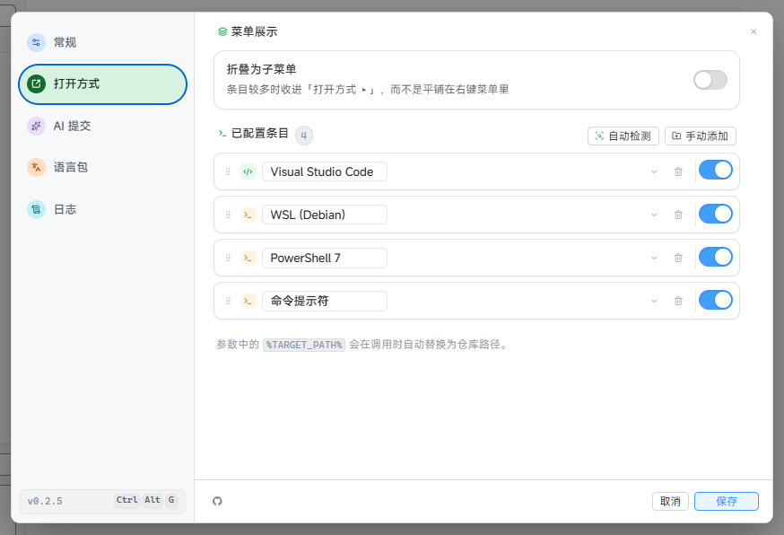
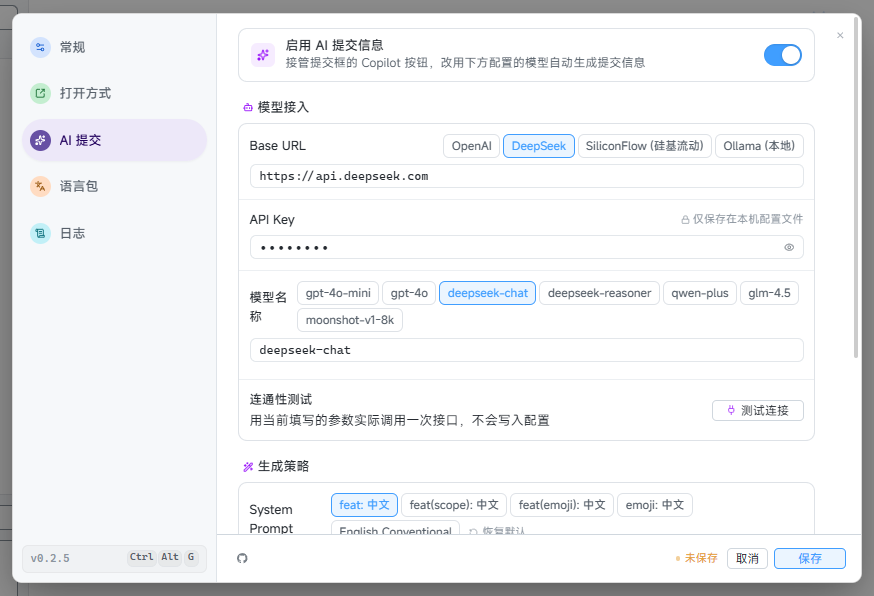
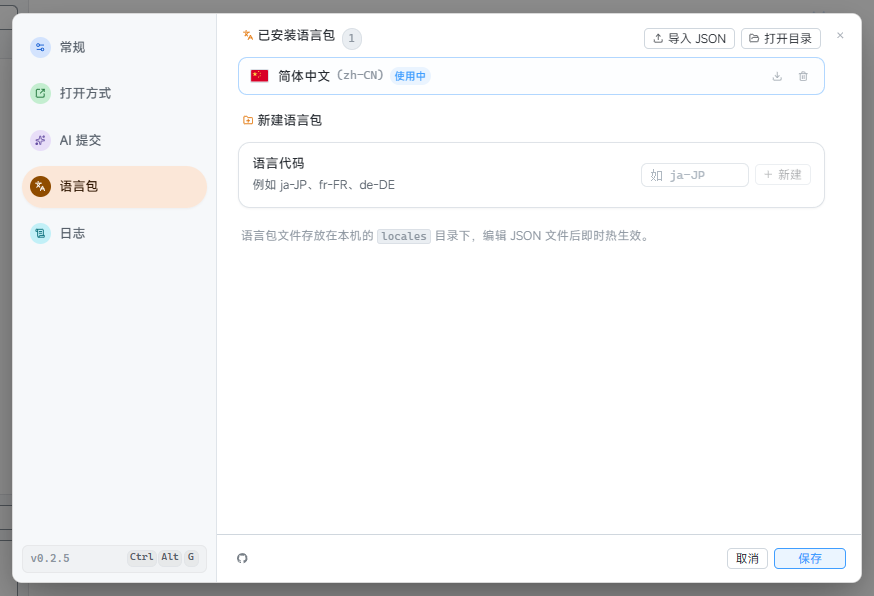

# GitHub Desktop Plus

A zero-patch runtime enhancement suite for GitHub Desktop. It injects custom AI commit generation, multi-editor & terminal launching, persistent Chinese localization, and seamless WSL 2 integration via the Chrome DevTools Protocol — leaving official binaries 100% clean and intact.

[English](README.md) · [简体中文](README.zh-CN.md)

---

## Features

- **Custom AI Commits**: Call custom AI endpoints directly from the native commit UI. Compatible with any OpenAI-compatible API (DeepSeek, Ollama, OpenAI, SiliconFlow, etc.), with custom prompt templates, token control, and latency testing.
- **Open With+ (Multi-Editor & Terminal)**: Launch editors and terminals from repository and file context menus (VS Code, Cursor, Zed, JetBrains IDEs, Windows Terminal, WSL distros, etc.) with drag-and-drop reordering.
- **Zero-Patch Chinese Localization (i18n)**: Full runtime UI translation for menus, dialogs, and views. Ships with built-in Simplified Chinese (`zh-CN`). Because translations are injected at runtime, official GitHub Desktop updates will not overwrite or break your localization.
- **WSL 2 Integration**: Manage repositories hosted inside WSL 2 from Windows with automatic `/mnt/c/` ↔ `\\wsl$\` path translation.
- **Privacy & Update Control**: Block background telemetry tracking and disable silent automatic updates with a single toggle.
- **Embedded Settings Panel**: Press `Ctrl+Alt+G` or click `GDP` in the menu bar to open settings. All modifications take effect immediately without restarting.
- **Zero Binary Modification**: Injected at launch via the official V8 Inspector protocol (CDP). No files in your GitHub Desktop installation are altered.

---

## Comparison

| Feature | Official GitHub Desktop | Traditional Patches | GitHub Desktop Plus (GDP) |
| :--- | :--- | :--- | :--- |
| **Localization** | ❌ English only | ⚠️ Overwrites `app.asar` (breaks on updates) | ✅ Runtime injection via CDP (upgrade-safe, no file changes) |
| **AI Commit Generation** | ⚠️ GitHub Copilot only (Subscription) | ❌ None | ✅ Any OpenAI-compatible endpoint (DeepSeek, Ollama, etc.) |
| **External Editors & Terminals** | ⚠️ Single default editor | ⚠️ Single default editor | ✅ Multiple editors & terminals in context menu (Open With+) |
| **WSL 2 Support** | ⚠️ Manual configuration | ⚠️ Manual configuration | ✅ Automatic `/mnt/c/` ↔ `\\wsl$\` path translation |
| **Binary Integrity** | ✅ Official binary | ❌ Modified files & broken signatures | ✅ 100% untouched official installation |
| **Telemetry & Updates** | ⚠️ Enabled by default | ⚠️ Enabled by default | ✅ One-click toggle to disable telemetry & silent updates |

---

## Screenshots

### Main Interface & Localization
Full runtime UI translation with a dedicated `GDP` menu.



### Core Features

| Custom AI Commits | Open With+ |
| :---: | :---: |
|  |  |
| Call custom LLMs from the native commit panel | Launch editors and terminals from context menus |

### Settings Panel (`Ctrl+Alt+G`)

| General Settings | Open With Settings |
| :---: | :---: |
|  |  |

| AI Commit Settings | Language Packs & Hot Reload |
| :---: | :---: |
|  |  |

---

## How It Works

GDP runs as a lightweight Rust launcher (< 10MB memory overhead). It starts GitHub Desktop with `--inspect-brk=0`, connects via the Chrome DevTools Protocol (CDP), and injects runtime hooks into the main and renderer processes:

```text
┌───────────────────────────┐         ┌──────────────────────────────┐
│  GDP (Rust Launcher)      │   CDP   │  GitHub Desktop (Electron)   │
│  • Embedded Hook Bundles  │────────→│  • Main Process Hook         │
│  • Embedded Settings UI   │         │    - Telemetry / Update Block│
│  • Embedded Locales       │         │    - AI Dispatcher & IPC     │
│                           │         │  • Renderer Process Hook     │
│                           │         │    - i18n DOM Translation    │
│                           │         │    - Copilot Button Hijack   │
│                           │         │    - Embedded Settings Modal │
└───────────────────────────┘         └──────────────────────────────┘
```

All IPC communication (settings, logs, AI requests, locales) runs directly inside the Electron process — no local HTTP server required.

---

## Installation

### Windows

1. Download `GitHubDesktopPlus-win-x64-Setup.exe` (or `Portable.zip`) from [Releases](https://github.com/sj817/github-desktop-plus/releases/latest).
2. Run the installer and launch **GitHub Desktop Plus**.

> **Note**: User settings and runtime data are stored in `%APPDATA%\github-desktop-plus`, preserving your configuration across updates.

#### In-App Updates & Mirrors
- Check for updates anytime via **GDP → Check for Updates** (or **GDP → 检查更新**).
- The updater supports direct GitHub downloads and acceleration mirrors (listed by [github.akams.cn](https://github.akams.cn/)) with automatic fallback. Mirror preference only applies to public release downloads.

### WSL 2

Install the `gdp` CLI command in WSL 2 with:

```bash
curl -fsSL https://raw.githubusercontent.com/sj817/github-desktop-plus/main/install.sh | bash
```

- Run `gdp` from any WSL terminal to launch GitHub Desktop with WSL path mapping.
- Optional: Set `GDP_DOWNLOAD_MIRROR=direct` to bypass mirrors, or specify a preferred mirror (`gh-proxy.com`, `ghfast.top`, etc.).

### Shortcuts

- `Ctrl+Alt+G`: Open or close the GDP settings modal (or click `GDP` in the menu bar).

---

## Contributing Translations

GDP provides runtime i18n interception with live hot-reloading. Currently, **Simplified Chinese (`zh-CN`)** is built-in. Contributions for other languages (Traditional Chinese, Japanese, Korean, etc.) are welcome.

### In-App Translation Editor
1. Press `Ctrl+Alt+G` to open Settings and navigate to **Language Packs**.
2. Create a new locale scaffold or import an existing JSON pack.
3. Edit strings with live hot-reloading.
4. Export the JSON and open a Pull Request.

### Codebase Translation
1. Check the modular JSON files under [`apps/gdp/resources/locales/zh-CN/`](apps/gdp/resources/locales/zh-CN).
2. Create a new directory under `apps/gdp/resources/locales/<locale-code>` (e.g. `ja-JP`, `zh-TW`).
3. Translate keys, verify with `pnpm locales:prepare <locale>`, and submit a PR.

---

## Development

### Prerequisites
- Node.js >= 22.18, pnpm 9.15.9
- Rust toolchain (stable)

### Commands

```bash
# Install dependencies
pnpm install

# Start development mode (Vite HMR + Hook watcher + GDP + GitHub Desktop)
pnpm dev

# Run settings UI standalone in browser (with mock bridge)
pnpm --filter @github-desktop-plus/settings-ui dev

# Run type checks
pnpm run typecheck

# Full production build
pnpm run build

# Build Windows installer and portable packages
pnpm run package:windows
```

---

## Disclaimer

GitHub Desktop Plus is an independent open-source project and is not affiliated with, endorsed by, or sponsored by GitHub, Inc. or Microsoft Corporation. GitHub and GitHub Desktop are registered trademarks of GitHub, Inc.

GitHub Desktop itself is licensed under the [MIT License](https://github.com/desktop/desktop/blob/development/LICENSE).

---

## License

[MIT](LICENSE)
